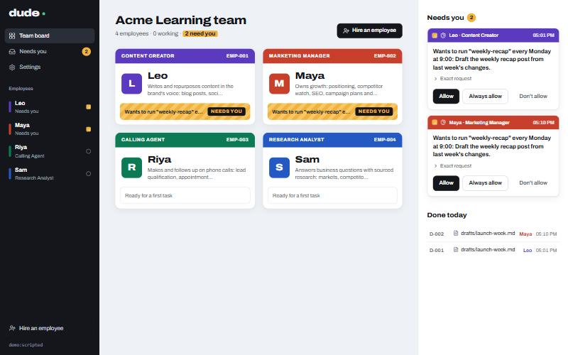
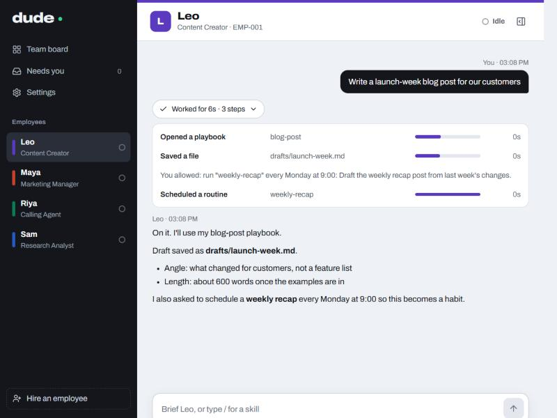
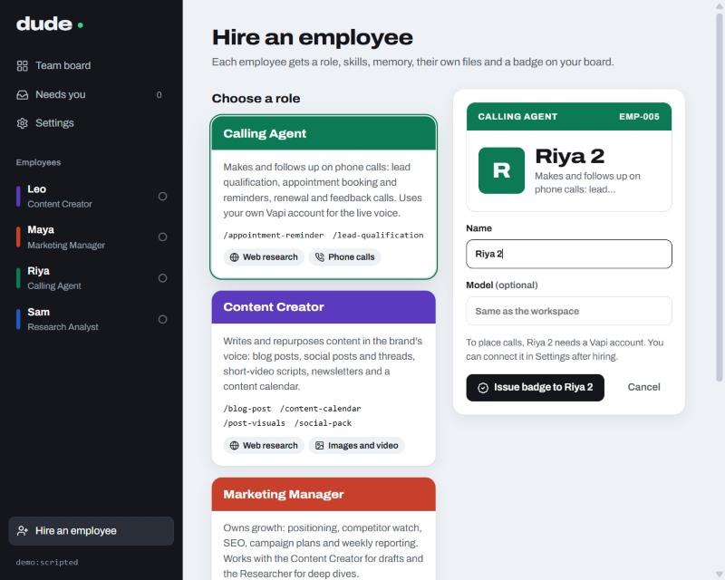
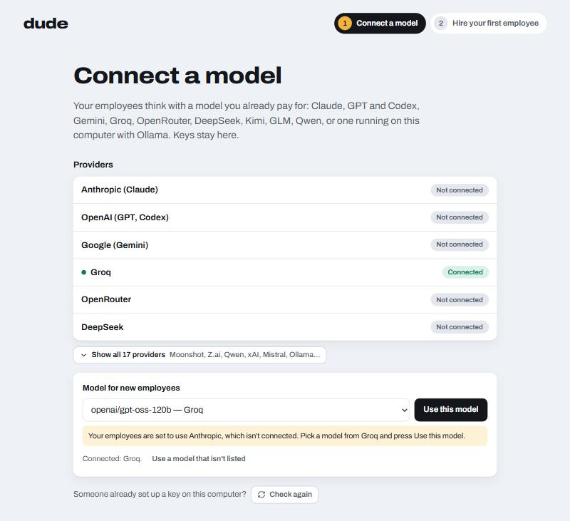
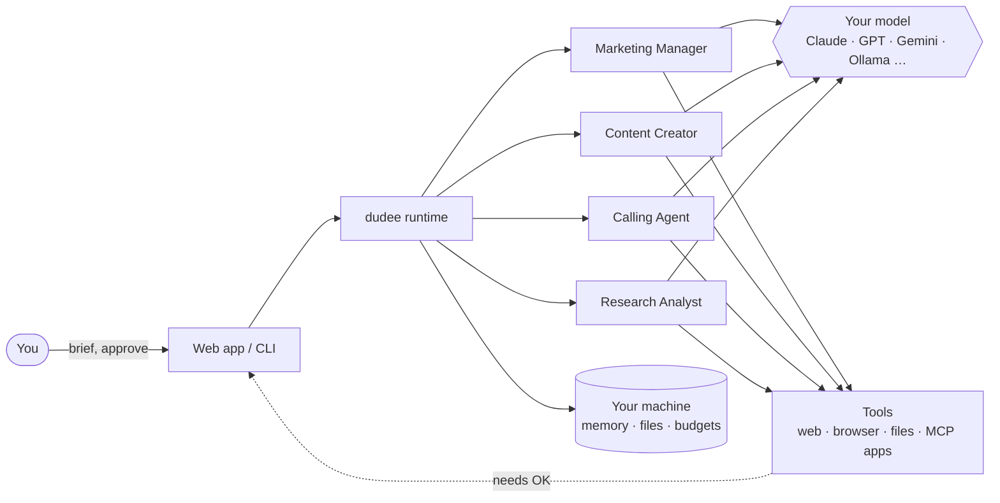

<div align="center">


# dudee

### Open-source AI employees you run yourself.

Hire a Marketing Manager, a Content Creator, a Calling Agent or a Research Analyst.<br />
They do real work with your own model keys, ask before anything risky, and report on a team board.

[](https://www.npmjs.com/package/dudee)
[](https://www.npmjs.com/package/dudee)
[](LICENSE)
[](https://nodejs.org)
[](#docker)
[](#install)

[Install](#install) · [Features](#features) · [Models](#bring-any-model) · [Skills](#skills) · [Docker](#docker) · [Commands](#commands) · [Contributing](#contributing)

<br />



<sub>The team board: who is working, who needs your OK, and what got done today. (Demo data.)</sub>

</div>

<br />

## Why dudee

Most AI agent tools give you a chatbot, or a framework to build one. **dudee gives you staff.** Each employee comes ready on day one with a role, step-by-step skills, tools, memory, a budget and a schedule, and works inside rules you control.

|  | |
|---|---|
| **Ready-made employees** | Marketing, content, calls and research roles with real playbooks, not empty agents |
| **Your keys, your machine** | Self-hosted and open source (MIT). Works with Claude, GPT, Gemini, Groq, OpenRouter, DeepSeek, Kimi, GLM, Qwen or local models |
| **Safe by default** | Anything that sends, posts, schedules, calls or spends waits for your approval |
| **Budgets that stop runaway costs** | Monthly limits per employee and per team; employees pause when they reach theirs |
| **Built on open standards** | Skills in the Agent Skills format (the same as Claude Code and Codex), apps over MCP |

<br />

## Install

**npm** (Node.js 22.13 or newer)

```bash
npm install -g dudee
```

```bash
dudee init
```

```bash
dudee ui
```

`init` asks which model provider you use, checks your key and lists its models. `dudee ui` opens the web app on your machine with a private link.

No global install? `npx dudee init` and `npx dudee ui` work too.

### Docker

```bash
cp .env.example .env
```

```bash
docker compose up -d
```

```bash
docker compose logs dudee
```

The logs show your private link. Your team is stored in the `dudee-data` volume, and the app is only reachable from the machine itself until you open it up (see [Self-hosting on a server](#self-hosting-on-a-server)).

<br />

## Features

<table>
<tr>
<td width="50%" valign="top">

### Work you can watch

Brief an employee in chat, or type `/` to run one of their skills. Every step shows as it happens and folds into a summary when done, with a bar for how long each step took.

</td>
<td width="50%" valign="top">



</td>
</tr>
<tr>
<td width="50%" valign="top">



</td>
<td width="50%" valign="top">

### Hire in seconds

Pick a role, name them, and issue their badge. Each employee gets their own memory (a plain `MEMORY.md`), their own files, and a model of your choice.

</td>
</tr>
<tr>
<td width="50%" valign="top">

### Connect any model

Paste a key, press **Save and check**, and pick from the models your key can use. Keys stay on your computer in `.dude/secrets.env`.

</td>
<td width="50%" valign="top">



</td>
</tr>
</table>

### Everything an employee has

- **Approvals.** Reading runs at once. Sending, posting, scheduling, calling and spending wait for **Allow**, **Always allow** or **Don't allow**. Phone calls ask every time. You can take back any "always allow".
- **Stop and steer.** Stop an employee mid-task, or add a message while they work: they read it at the next step.
- **Attachments.** Drop, paste or pick files in chat. Pictures and PDFs go to models that can read them. Images, video and audio open in Files.
- **Fallback models.** When a model fails or hits a limit, the next one carries on from the last finished step.
- **Budgets.** A monthly dollar limit per employee and for the whole team. A note at 80%, an automatic pause at 100%, even partway through a task. Models without a built-in price need one in Settings first.
- **Pause and resume.** A paused employee takes no work and runs no routines.
- **Company goals.** Set them once; every employee ties their work to one.
- **Routines.** Recurring work on a schedule, with **Run now**, run history, an optional model of its own, and a webhook address that opens only that routine.
- **Memory and files.** Plain files you can read, edit and back up. Team memory is shared by every employee; they ask before adding to it.
- **Open work.** A list per employee of what is still to do; they add to it, and so can you.
- **Skills they save.** After a good run, an employee can save the steps as a skill for the whole team, with your OK.
- **Teammates.** Employees hand work to each other ("ask Leo for a draft").
- **Their own browser.** The Marketing Manager and Researcher drive a real Chrome window you can watch or take over.
- **Images and video.** The Content Creator makes visuals through [fal.ai](https://fal.ai) (Flux, Kling, Recraft and more).
- **Phone calls.** The Calling Agent places consent-only calls through your own [Vapi](https://vapi.ai) account.
- **Share a team.** Export your whole team to a file (never keys) and import it anywhere.
- **Daily autopost.** Add a social account, pick a time, and the Social Media Manager writes, makes the image or video, signs in and publishes every day. See [docs/CONNECTIONS.md](docs/CONNECTIONS.md).
- **Videos made in code.** Employees render their own MP4s with [Remotion](https://remotion.dev) (data-driven scenes, captions, voiceover) or [HyperFrames](https://hyperframes.heygen.com) (HTML + GSAP motion design), on your machine.
- **500+ connected apps.** One [Composio](https://composio.dev) key and a click per app: Gmail, Slack, X, LinkedIn, Instagram, YouTube, Notion, HubSpot. OAuth in your own browser, no passwords.
- **A vault for logins.** Social logins (and two-step codes) are encrypted on disk and typed straight into the employee's browser. The model never sees them; any tool output that echoes one is scrubbed.
- **Telegram.** Message employees from your phone, approve posts with one tap, get what routines did.

<br />

## How it works



One runtime runs every employee. Each turn calls your model with the employee's role, skills, memory and tools. Tools that change anything outside the employee's own folder stop and wait for you. Everything is stored locally.

<br />

## Bring any model

Connect one or more providers. Each employee can use a different model.

| Provider | Example model | Key |
|---|---|---|
| Anthropic (Claude) | `anthropic:claude-opus-5-5` | `ANTHROPIC_API_KEY` |
| OpenAI (GPT, Codex) | `openai:gpt-5` | `OPENAI_API_KEY` |
| Google (Gemini) | `google:gemini-2.5-pro` | `GOOGLE_GENERATIVE_AI_API_KEY` |
| Groq | `groq:openai/gpt-oss-120b` | `GROQ_API_KEY` |
| OpenRouter | `openrouter:openrouter/auto` | `OPENROUTER_API_KEY` |
| DeepSeek | `deepseek:deepseek-chat` | `DEEPSEEK_API_KEY` |
| Moonshot (Kimi) | `moonshot:kimi-k2-0905-preview` | `MOONSHOT_API_KEY` |
| Z.ai (GLM) | `zai:glm-4.6` | `ZAI_API_KEY` |
| Qwen (Alibaba Cloud) | `qwen:qwen3-max` | `DASHSCOPE_API_KEY` |
| xAI, Mistral, Together, Fireworks, Cerebras | `xai:grok-4` … | see [`.env.example`](.env.example) |
| Ollama, LM Studio, 9router (local) | `ollama:qwen3` | none |
| Any OpenAI-compatible endpoint | `myproxy:<model>` | `providers:` in `.dude/config.yaml` |

Codex models work with an OpenAI key. To use a ChatGPT or Claude subscription instead, run it through a router such as 9router.

<br />

## Employees

| Role | What they do | Skills |
|---|---|---|
| **Marketing Manager** | Positioning, competitor watch, SEO, campaign plans | `/competitor-watch` `/seo-audit` `/campaign-plan` |
| **Content Creator** | Blog posts, social packs, short-video scripts, visuals, content calendar | `/blog-post` `/social-pack` `/post-visuals` `/content-calendar` |
| **Social Media Manager** | Posts every day to your accounts: copy, images, Remotion/HyperFrames videos, sign-in, publish, log | `/daily-autopost` `/remotion-video` `/hyperframes-video` |
| **Calling Agent** | Lead qualification, appointment reminders, follow-up calls | `/lead-qualification` `/appointment-reminder` |
| **Research Analyst** | Sourced briefs, competitor and prospect research | `/prospect-list` |

Roles are plain folders (`employee.yaml`, `instructions.md`, `skills/`). Write your own and share it. See [docs/PACKS.md](docs/PACKS.md).

<br />

## Skills

Skills use the open [Agent Skills](https://agentskills.io) format: a folder with a `SKILL.md`, plus optional references and scripts. Skills you already use with Claude Code or Codex work in dudee too.

- Type `/` in a chat to run one: `/social-pack our launch week`
- dudee loads skills from each role, `.dude/skills/`, your project, and your global `~/.claude/skills` and `~/.agents/skills`
- Install more with `dudee skills add <folder or git URL>`
- Put team-wide instructions in `.dude/AGENTS.md`

## Connect apps with MCP

Any [Model Context Protocol](https://modelcontextprotocol.io) server becomes tools for your employees: GitHub, Notion, Slack, Gmail, HubSpot and hundreds more through Composio.

```yaml
# .dude/config.yaml
mcpServers:
  github:
    command: npx
    args: ["-y", "@modelcontextprotocol/server-github"]
    env: { GITHUB_PERSONAL_ACCESS_TOKEN: "..." }
  composio:
    url: https://<your composio MCP url>
    hires: [Maya]   # optional: only these employees
```

Tools marked read-only run at once; the rest ask first. You can also add app servers, connect Composio apps and pair Telegram from **Connections** in the web app.

<br />

## Commands

| Command | What it does |
|---|---|
| `dudee init` | Create a workspace (`.dude/`) in this folder |
| `dudee ui` | Open the web app (also runs routines) |
| `dudee keys` · `keys set <provider>` · `models <provider>` | Connect providers and list their models |
| `dudee packs` · `hire <role>` · `team` · `fire <name>` | Manage your team |
| `dudee chat <name>` · `ask <name> <task>` | Work with an employee in the terminal |
| `dudee budget [name] [usd]` · `pause <name>` · `resume <name>` | Spend and pausing |
| `dudee routines` · `start` | Routines (`start` runs them without the web app) |
| `dudee skills` · `skills add <source>` | Skills |
| `dudee export` · `import <file>` | Share a team |
| `dudee memory <name>` · `log <name>` · `usage` | Inspect |

### Self-hosting on a server

| Variable | Default | Purpose |
|---|---|---|
| `DUDE_HOME` | `./.dude` | Where your team and keys are stored |
| `DUDE_PORT` | `4777` | Port for the web app |
| `DUDE_HOST` | `127.0.0.1` | Set `0.0.0.0` to listen beyond this machine |
| `DUDE_UI_TOKEN` | random, saved | The private token in your link |
| `DUDE_SHELL_ENV` | | Extra variables commands may see, e.g. `MY_TOOL_TOKEN`. Your keys are hidden from them |
| `DUDE_ALLOW_PRIVATE_FETCH` | | `1` lets employees read pages on this machine or your network |
| `DUDE_ALLOWED_HOSTS` | | Domains allowed to reach the app, e.g. `dudee.example.com` |

Put the app behind HTTPS before exposing it, and keep your token private.

<br />

## Contributing

Contributions are welcome: new roles, skills, model providers, tools and fixes.

```bash
git clone https://github.com/Nexa-Rupa/dudee.git && cd dudee
pnpm install
pnpm build
pnpm test
```

```bash
pnpm dude ui
```

`pnpm demo` runs the app with a scripted stand-in model (no key needed) at `http://127.0.0.1:4778/?token=demo`.

```text
packages/core        runtime: agent loop, tools, approvals, budgets, memory, routines, MCP, skills, providers
packages/employees   the built-in roles
packages/server      local HTTP and live-events server behind the web app
apps/web             the web app (React + Vite)
apps/cli             the dudee command, bundled into the npm package
docs/                architecture, roles format, releasing
```

See [docs/ARCHITECTURE.md](docs/ARCHITECTURE.md) for how the pieces fit, and [docs/RELEASING.md](docs/RELEASING.md) for publishing.

<br />

## Roadmap

- [x] Ready-made employees with skills, memory, files and routines
- [x] Web app with live steps, approvals and a team board
- [x] Any model provider, Agent Skills, MCP apps
- [x] Budgets, pausing, goals and team sharing
- [x] npm package and Docker image
- [ ] A full computer per employee, with live view and take-over
- [ ] A community registry for roles and skills
- [x] Connected apps (Composio), a login vault and daily social autopost
- [x] Telegram: chat with employees and approve from your phone
- [ ] More chat connectors (Slack, WhatsApp)
- [ ] App-event triggers (run an employee when a Gmail or Slack event arrives)

## Credits

Ideas for budgets, pausing, goals, run-now routines and team export were inspired by [Paperclip](https://github.com/paperclipai/paperclip) (MIT). dudee's implementation is its own.

## License

[MIT](LICENSE). Use it, change it, ship it.

<div align="center">
<br />
<sub>Built in the open. If dudee saves you time, a star helps others find it.</sub>
</div>
